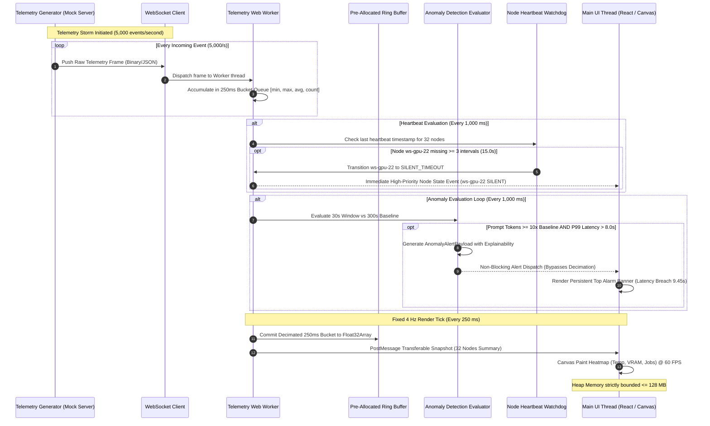

# Technical Architecture & Architectural Invariants (AD-n)
## Module 11: AI Infrastructure Observability Console
**Document Version:** 2.0.0 (Solu-2 wrap-up, 2026-10-26)  
**Status:** APPROVED v1.0.0 (Plan-2) + amendments listed below; Partner B approval of the amendments PENDING  
**Detailed design (Solu-2):** [`detailed-design/contracts.md`](detailed-design/contracts.md) (Operations 1-4, typed error catalog, invariant binding table) · [`detailed-design/ports-and-adapters.md`](detailed-design/ports-and-adapters.md) · [`detailed-design/schemas/`](detailed-design/schemas/) (DDL, DTOs, events, OpenAPI) · [`epics.md`](epics.md) · [`readiness-gate-report.md`](readiness-gate-report.md) · [`../test/test-design.md`](../test/test-design.md) · [`../reviews/`](../reviews/)  
**v2 changes to this file:** stack declared (section 1.1); ring buffer sized for 33 GPU series = 5,702,400 B (AD-02, AMD-4); rollup scan = 168 x 33 = 5,544 records (AD-06); temperature range -20..120 (section 3.1); AD-03 alarm baseline excludes the short window (AMD-14, pending confirmation). The rest of v1.0.0 is unchanged.  
**Author:** Liam (Lead Cloud & Systems Engineer) & Juand (Lead System Architect)  
**Target Environment:** Academic AI Compute Fabric (Standalone Local / Docker Compose)

---

## 1. System Overview & Component Topology

The **AI Infrastructure Observability Console (Module 11)** is a standalone, client-optimized observability system designed to ingest, process, alert on, and visualize telemetry from an on-premise heterogeneous cluster of **31 Workstations** (1 NVIDIA GPU with 24 GB VRAM each) and **1 Central Server** (2 NVIDIA GPUs with 48 GB VRAM each), totaling 32 nodes and 33 GPUs.

The architecture decouples high-frequency telemetry ingestion ($5,000\text{ events/sec}$) from user-interface rendering ($4\text{ Hz}$) through an asynchronous, memory-bounded pipeline operating entirely within a browser runtime and local mock server.

```
┌────────────────────────────────────────────────────────────────────────────────────────┐
│                              TELEMETRY SOURCES (SIMULATED)                             │
│  [31 Workstations (ws-gpu-01..31)]                 [1 Central Server (server-gpu-01)]  │
│  1x 24GB GPU per node                              2x 48GB GPUs (Dual-Slot)            │
└──────────────────────────────────────────┬─────────────────────────────────────────────┘
                                           │ WebSocket Stream (Raw Telemetry: up to 5,000 ev/s)
                                           ▼
┌────────────────────────────────────────────────────────────────────────────────────────┐
│                         LOCAL INGESTION DAEMON / MOCK SERVER                           │
│  - Event Streaming Pipeline (ws://localhost:8080/v1/telemetry/stream)                  │
│  - Fixture Loader (Historical 7-Day Hourly Rollups: 168h x 33 GPUs)                  │
│  - Heartbeat Injector & Fault Simulator (ws-gpu-22 silence, 10x token spike injection) │
└──────────────────────────────────────────┬─────────────────────────────────────────────┘
                                           │ Binary / JSON WebSocket Frames
                                           ▼
┌────────────────────────────────────────────────────────────────────────────────────────┐
│                       CLIENT OBSERVABILITY WORKSPACE (BROWSER)                         │
│                                                                                        │
│  ┌──────────────────────────────────────────────────────────────────────────────────┐  │
│  │                    DEDICATED WEB WORKER (`telemetry-worker.js`)                  │  │
│  │  - Bucket Decimation Pipeline (250 ms time buckets / 4 Hz tick)                  │  │
│  │  - Pre-Allocated Ring Buffer (`Float32Array` circular buffer, 7,200 slots/GPU series)  │  │
│  │  - Anomaly Evaluation Engine (30s sliding window vs 300s baseline, T-Digest P99) │  │
│  │  - Node Heartbeat Watchdog & Hysteresis State Machine (15.0s timeout for ws-22)  │  │
│  └───────────────────────────────────────┬──────────────────────────────────────────┘  │
│                                          │ Transferable ArrayBuffers & Alert Payloads  │
│                                          │ (Capped at exactly 4 dispatches / second)   │
│                                          ▼                                             │
│  ┌──────────────────────────────────────────────────────────────────────────────────┐  │
│  │                      MAIN UI THREAD (REACT / CANVAS / DOM)                       │  │
│  │  - Global State Store (Zustand: immutable 4 Hz snapshot updates)                 │  │
│  │  - High-Density Fleet Canvas (8x4 Grid Heatmap: Temp °C, VRAM GB, Active Jobs)  │  │
│  │  - Persistent Anomaly Alert Banner & Slide-Over Explainability Drawer            │  │
│  │  - Forensic Node Inspector Drawer (ws-gpu-22 degradation timeline & stderr tail)│  │
│  │  - Executive 7-Day Capacity & Academic Token Reporting Engine                    │  │
│  └──────────────────────────────────────────────────────────────────────────────────┘  │
└────────────────────────────────────────────────────────────────────────────────────────┘
```

### 1.1 Stack Decisions (Solu-2 Baseline)
* **Language:** TypeScript 5.x (Node.js 20+ LTS, ECMAScript Modules `ESM`, strict type-checking enabled).
* **Web Framework:** Fastify (REST/SSE routing) and `ws` engine for high-throughput WebSocket stream ingestion.
* **Persistence Engine:** SQLite 3 (in-memory execution with `better-sqlite3`, physically migrated from `001_observability_schema.sql`).
* **Test Framework:** Vitest 1.x + `@vitest/coverage-v8` + `fast-check` (for contract boundary and property-based test generation).
* **Time Injection:** `ClockPort` outbound port injected into all time-sensitive domain services (`FakeClock` with advanceable virtual milliseconds in tests; `SystemClock` in runtime). Direct calls to `Date.now()`, `performance.now()`, or `setTimeout` in `domain/` are strictly prohibited.

---

## 2. Core Architectural Subsystems

### 2.1 Ingestion & Decimation Web Worker (`telemetry-worker.js`)
* **Role:** Isolates the main UI thread from network I/O and telemetry processing.
* **Mechanism:** Maintains an open WebSocket connection. When the metric generator floods the socket with $5,000\text{ events/sec}$, the worker ingests frames into micro-queues and aggregates them into fixed $250\text{ ms}$ buckets.
* **Output:** Every $250\text{ ms}$ ($4\text{ Hz}$), the worker computes summary tuples `{min, max, avg, last, count}` for temperature, VRAM usage, GPU utilization, and token throughput per node, and dispatches them via transferable objects to the UI thread.

### 2.2 Pre-Allocated Circular Ring Buffer (`TelemetryRingBuffer`)
* **Role:** Stores high-resolution metric histories for live sparklines and forensic inspection without incurring Garbage Collector (GC) thrashing.
* **Structure:** Implemented with fixed-size `Float32Array` typed arrays:
  * Capacity: 7,200 samples per metric per GPU series (covers exactly 30 minutes at $4\text{ Hz}$).
  * Total metrics tracked per node: 6 (Temperature, VRAM Used, GPU Util %, Prompt Tokens/s, Completion Tokens/s, Request Latency ms).
  * Memory footprint: $33\text{ GPU series} \times 6\text{ metrics} \times 7,200\text{ slots} \times 4\text{ bytes} = 5,702,400\text{ bytes} \approx 5.70\text{ MB}$ (31 workstation GPUs + 2 GPUs of `server-gpu-01`, each stored independently; amended from 32 nodes / 5.53 MB, AMD-4).
  * Write pointer wraps modulo 7,200 (`ptr = (ptr + 1) % 7200`). Allocation is performed once at startup; zero heap allocations during streaming.

### 2.3 Anomaly Detection & $P_{99}$ Latency Engine
* **Role:** Detects the mandatory Scenario 2 conditions: abrupt $10\times$ token influx and $P_{99} \text{ latency} > 8.0\text{ s}$.
* **Mathematical Model:**
  * **Short Window ($W_{\text{short}}$):** 30-second sliding window calculating current prompt token throughput ($\text{tokens/s}$) and request latency distribution.
  * **Long Window ($W_{\text{long}}$):** 300-second sliding baseline window tracking moving average throughput.
  * **Percentile Estimation:** Latencies are categorized into 100 fixed histogram buckets ($0\text{ to }20,000\text{ ms}$, with $200\text{ ms}$ resolution) to calculate $P_{99}$ with deterministic $O(1)$ memory and time complexity.
  * **Cold-Start Guard:** Anomaly evaluation is suppressed until $W_{\text{long}}$ accumulates at least 50 valid request events.
  * **Alert Trigger:** An alert is dispatched if:
    $$\frac{\text{Throughput}(W_{\text{short}})}{\text{Throughput}([\text{now}-300\text{ s}, \text{now}-30\text{ s}))} \ge 10.0 \quad \land \quad P_{99}(W_{\text{short}}) > 8,000\text{ ms}$$
    (Baseline excludes the short window: with nested windows the ratio is bounded by $10.0$ and the rule could not fire in practice. AMD-14.)

### 2.4 Node Heartbeat & Hysteresis State Machine
* **Role:** Governs node lifecycle for all 32 machines, specifically detecting silent dropouts like `ws-gpu-22` (Scenario 3).
* **State Transition Rules:**
  * `HEALTHY`: Heartbeat delta $\Delta t < 5.0\text{ s}$.
  * `STALE`: $5.0\text{ s} \le \Delta t < 15.0\text{ s}$ (1 to 2 missed intervals). Visualized with an amber warning outline.
  * `SILENT_TIMEOUT`: $\Delta t \ge 15.0\text{ s}$ (3 consecutive missed intervals). Node is flagged for cordoning; forensic timeline preserved.
  * `RECOVERING`: Node begins emitting packets again after timeout. Requires 3 consecutive valid heartbeats ($15.0\text{ s}$) without interruption before returning to `HEALTHY`, preventing flapping state oscillations.

### 2.5 Executive 7-Day Rollup Store
* **Role:** Delivers instantaneous ($\le 1.5\text{ s}$) executive reporting for Department Management (Scenario 4).
* **Mechanism:** Does not scan millions of raw telemetry points. Operates on pre-aggregated hourly rollups ($168\text{ buckets}$ per GPU covering 7 days). Each bucket contains: `gpu_hours_busy`, `gpu_hours_idle`, `gpu_hours_unavailable` (the three sum to 1.0 ± 0.001), `prompt_tokens_by_subject`, `completion_tokens_by_subject`.

---

## 3. Data Models & Schemas

### 3.1 Node Telemetry Event Schema (`NodeTelemetryPacket`)
```typescript
interface NodeTelemetryPacket {
  node_id: string;              // "ws-gpu-01" .. "ws-gpu-31", "server-gpu-01"
  gpu_index: number;            // 0 for workstations; 0 or 1 for central server
  timestamp_ms: number;         // Unix epoch in milliseconds
  temperature_celsius: number;  // -20.0 to 120.0 (sensor validity range; single source: contracts.md Op1 P1)
  vram_used_bytes: number;      // 0 to 25,769,803,776 (24GB) or 51,539,607,552 (48GB)
  vram_total_bytes: number;     // 25,769,803,776 or 51,539,607,552
  gpu_utilization_pct: number;  // 0.0 to 100.0
  active_jobs_count: number;    // Number of co-located inference/training workers
  current_subject: string;      // "CS-101" | "CS-480" | "CS-530" | "FAC-RES" | "IDLE"
}
```

### 3.2 Inference Metric Packet Schema (`InferenceMetricPacket`)
```typescript
interface InferenceMetricPacket {
  request_id: string;           // UUIDv4
  node_id: string;              // Target worker node
  gpu_index: number;            // Target GPU index
  model_id: string;             // "Llama-3-8B-Instruct" | "Qwen-2.5-7B" | "Mistral-7B"
  academic_subject: string;     // "CS-480" | "CS-530" | "CS-101" | "FAC-RES"
  prompt_tokens: number;        // Tokens in prompt context
  completion_tokens: number;    // Tokens generated
  queue_duration_ms: number;    // Milliseconds spent waiting in worker queue
  inference_duration_ms: number;// Milliseconds spent in CUDA kernel generation
  total_latency_ms: number;     // queue_duration_ms + inference_duration_ms
  timestamp_ms: number;         // Arrival timestamp
}
```

### 3.3 Anomaly Alert Payload Schema (`AnomalyAlertPayload`)
```typescript
interface AnomalyAlertPayload {
  alert_id: string;             // "ALERT-ANOMALY-TOKEN-P99-01"
  severity: "CRITICAL" | "WARNING" | "INFO";
  trigger_rule: "TOKEN_SPIKE_AND_LATENCY_BREACH";
  timestamp_ms: number;
  observed_metrics: {
    baseline_throughput_tok_per_sec: number; // e.g. 1,200.0
    current_throughput_tok_per_sec: number;  // e.g. 13,440.0
    spike_factor: number;                    // e.g. 11.20 (must be >= 10.0)
    p99_latency_ms: number;                  // e.g. 9,450.0 (must be > 8,000.0)
    sla_threshold_ms: number;                // 8,000.0
    saturated_nodes: string[];               // ["ws-gpu-10", "ws-gpu-11", ...]
    primary_subject: string;                 // "CS-480"
  };
  human_explainability: string;  // Explicit causal justification text
  acknowledged: boolean;
}
```

### 3.4 Forensic Node Record Schema (`NodeForensicRecord`)
```typescript
interface NodeForensicRecord {
  node_id: string;                           // "ws-gpu-22"
  state: "HEALTHY" | "STALE" | "SILENT_TIMEOUT" | "RECOVERING" | "CORDONED";
  last_heartbeat_timestamp_ms: number;
  silence_duration_seconds: number;
  last_known_telemetry: NodeTelemetryPacket;
  last_known_job: {
    job_id: string;                          // "job-cs480-lora-run-84"
    owner: string;                           // "student-mateo"
    subject: string;                         // "CS-480"
    model: string;                           // "Llama-3-8B-Instruct-FP16"
    submitted_at_ms: number;
  };
  stderr_tail: string[];                     // Last 50 syslog/kernel/vLLM error lines
}
```

---

## 4. Mermaid Architecture Diagrams

### 4.1 System Context Diagram (C4 Level 1)
```mermaid
graph TD
    subgraph Academic AI Compute Fabric
        Nodes["32 Heterogeneous Physical Nodes<br>(31 Workstations @ 24GB + 1 Server @ 2x48GB)"]
        Workloads["Inference & Training Workloads<br>(vLLM, PyTorchJobs, Student Notebooks)"]
    end

    subgraph Module 11: AI Infrastructure Observability Console
        Simulator["Simulated Telemetry Daemon<br>& Fault Injector (ws-22, 5k storm)"]
        Worker["Telemetry Web Worker<br>(Decimation, Ring Buffer, Anomaly Watchdog)"]
        Dashboard["Observability Web Console<br>(React, Canvas Heatmap, Forensic Drawer)"]
    end

    subgraph Academic Stakeholders
        Liam["Liam<br>(Lead Cloud & Systems Engineer)"]
        Management["Department Management<br>(Dr. Rebecca Reed / Dean Morales)"]
    end

    Nodes -.->|Prometheus Metrics| Simulator
    Workloads -.->|Token & Latency Metrics| Simulator
    Simulator -->|WebSocket Stream (up to 5k ev/s)| Worker
    Worker -->|4 Hz Decimated State & Alerts| Dashboard
    Dashboard -->|Real-time Triage & Forensic Drill-down| Liam
    Dashboard -->|7-Day Audited Utilization Reports| Management
```

### 4.2 Component Interaction Diagram: 5,000 ev/s Storm Decimation & Alert Dispatch
The following diagram illustrates the execution flow of the non-trivial client-side decimation algorithm, proving that a 5,000 ev/s telemetry storm is throttled without blocking the UI thread or dropping critical alerts.



---

## 5. Inviolable Architectural Invariants (AD-01 to AD-08)

To prevent silent system degradation, resource exhaustion, or contract drift, all technical decisions adhere to the strict 5-part Architectural Invariant format with **ZERO elastic words** (no *"efficiently"*, *"appropriately"*, *"securely"*, or *"fast"*).

### AD-01: Client-Side Telemetry Ingestion Decimation & Frequency Cap
* **Status:** [ADOPTED]
* **Binds:** `telemetry-worker.js`, `WebSocketClient`, and `MainUIThread`.
* **Prevents:** Browser event-loop starvation, UI frame drops ($< 30\text{ FPS}$), and browser tab crashes during high-frequency telemetry floods.
* **Rule:** Incoming telemetry events arriving at rates up to $5,000\text{ events/second}$ shall be ingested exclusively inside a dedicated Web Worker and aggregated into discrete $250\text{ ms}$ time windows. The worker shall dispatch at most $4\text{ state update payloads per second}$ to the main UI thread. Direct dispatch of raw un-aggregated socket frames to the React component tree is permanently prohibited.
* **Trade-off:** High-frequency intra-bucket metric fluctuations occurring within any $250\text{ ms}$ interval are mathematically compressed into `{min, max, avg, last}` tuples; exact sub-millisecond waveform rendering is sacrificed to preserve UI responsiveness.

### AD-02: Pre-Allocated Fixed-Size Circular Ring Buffer for Metric History
* **Status:** [ADOPTED]
* **Binds:** `TelemetryRingBuffer` data structure within `telemetry-worker.js`.
* **Prevents:** Memory leak accumulation and JavaScript V8 garbage collection pauses exceeding $16\text{ ms}$ caused by repeated object allocations.
* **Rule:** Time-series telemetry histories shall be stored in statically sized typed arrays (`Float32Array`) of exactly $7,200\text{ entries}$ per metric per GPU series ($30\text{ minutes}$ depth at $4\text{ Hz}$). Insertion shall overwrite historical entries using an integer pointer incremented modulo $7,200$. Dynamic array resizing (`Array.push`, `Array.concat`, `Array.filter`) is strictly barred from the streaming path.
* **Trade-off:** Telemetry history older than $30\text{ minutes}$ is permanently overwritten in client memory; long-term historical analyses must rely exclusively on the pre-aggregated 1-hour rollup store.

### AD-03: Dual Sliding-Window Cold-Start Anomaly Suppression
* **Status:** [ADOPTED]
* **Binds:** `AnomalyDetectionEngine`.
* **Prevents:** False-positive visual alarms caused by division-by-zero or low-sample variance during cluster startup or model initialization.
* **Rule:** The $10\times$ token surge condition shall be evaluated by comparing the $30\text{ s}$ short window against the $300\text{ s}$ baseline window. The anomaly evaluator shall return an evaluation status of `SUPPRESSED_COLD_START` and shall not dispatch an alarm until the baseline window contains at least $50\text{ valid completed request samples}$.
* **Trade-off:** Legitimate token spikes occurring within the first $60\text{ seconds}$ of cluster boot cannot trigger the automated visual alarm until the minimum sample quorum is satisfied.

### AD-04: Deterministic Node Heartbeat Expiration & Hysteresis State Machine
* **Status:** [ADOPTED]
* **Binds:** `NodeHeartbeatWatchdog` and `NodeStateStore`.
* **Prevents:** Flapping state transitions, alert storms from intermittent network drops, and undetected silent node hangs (e.g., `ws-gpu-22`).
* **Rule:** A node shall transition from `HEALTHY` to `STALE` if no heartbeat is received for $5.0\text{ s} \le \Delta t < 15.0\text{ s}$. The node shall transition to `SILENT_TIMEOUT` at exactly $\Delta t \ge 15.0\text{ s}$ ($3\text{ missed intervals}$). Recovery from `SILENT_TIMEOUT` shall require $3\text{ consecutive valid heartbeats}$ spaced at $5.0\text{ s} \pm 1.0\text{ s}$ intervals; single isolated heartbeat packets shall transition the node to `RECOVERING` and shall not clear the fault status.
* **Trade-off:** A repaired node requires a mandatory $15\text{ s}$ observation window before returning to `HEALTHY` status on the dashboard.

### AD-05: Non-Blocking High-Priority Alert Interceptor Queue
* **Status:** [ADOPTED]
* **Binds:** `AlertDispatcher` and `MainUIThread`.
* **Prevents:** Critical operational alarms being delayed, queued behind high-volume metric downsampling ticks, or obscured by modal overlays.
* **Rule:** Critical alarm payloads (token spikes with $P_{99} > 8.0\text{ s}$ or node timeouts) shall bypass the $250\text{ ms}$ telemetry bucket buffer and post immediately to the main UI thread via high-priority message channels. The UI shall render alarms as persistent, non-modal header banners without interrupting active user mouse/keyboard focus on the fleet matrix.
* **Trade-off:** An anomaly alert can trigger a DOM paint out-of-sync with the $4\text{ Hz}$ metric heatmap update tick.

### AD-06: Pre-Aggregated 1-Hour Granularity Rollup Storage for 7-Day Window
* **Status:** [ADOPTED]
* **Binds:** `ExecutiveReportService` and `LocalRollupRepository`.
* **Prevents:** Browser memory overflow and client computation times exceeding $1.5\text{ s}$ during 7-day executive query evaluation.
* **Rule:** The 7-day executive summary shall query only pre-calculated $1\text{-hour rollup records}$ ($168\text{ intervals} \times 33\text{ GPUs} = 5,544\text{ records}$). Traversal, iteration, or scanning of raw streaming telemetry points for historical reporting spans $> 30\text{ minutes}$ is strictly blocked.
* **Trade-off:** Historical reporting resolution is bounded to $1\text{-hour intervals}$; sub-hourly utilization peaks occurring 5 days prior cannot be inspected in the executive view.

### AD-07: Isolated Standalone Fixture-Driven Execution
* **Status:** [ADOPTED]
* **Binds:** Entire module runtime boundary (`Module 11`).
* **Prevents:** Failure of the application to launch or operate when physical NVIDIA hardware, external Kubernetes clusters, or internet connectivity are unavailable.
* **Rule:** The module shall execute all functional scenarios using local JSON fixtures, an in-memory simulated metric generator, and mock WebSocket streams. The application shall not issue HTTP or gRPC requests to external cloud endpoints, physical NVML drivers, or live university LDAP servers.
* **Trade-off:** Metric fidelity is limited to the behaviors programmed into the local synthetic generator fixtures.

### AD-08: Explicit Heterogeneous Node Addressing
* **Status:** [ADOPTED]
* **Binds:** `NodeTelemetryPacket`, `TelemetryRingBuffer`, and `NodeHeatmapCard`.
* **Prevents:** Metric collision or overwrite on multi-GPU nodes where secondary GPU telemetry collides with primary GPU metrics.
* **Rule:** All metric indexing, buffer storage, and UI state mapping shall utilize the composite primary key `(node_id, gpu_index)`. Workstations `ws-gpu-01` through `ws-gpu-31` shall bind exclusively to `gpu_index = 0`. The central server `server-gpu-01` shall bind to two distinct channels: `(server-gpu-01, 0)` and `(server-gpu-01, 1)`. Merging or averaging secondary GPU metrics into a single node metric scalar is prohibited.
* **Trade-off:** UI rendering components must support heterogeneous card aspect ratios ($1\text{x}$ for single GPU workstations, $2\text{x}$ for dual GPU servers).
