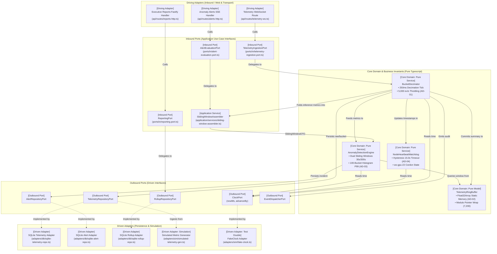

# Hexagonal Architecture Mapping (Ports & Adapters)
## Module 11: AI Infrastructure Observability Console
**Document Path:** `planning/detailed-design/ports-and-adapters.md`  
**Status:** AMENDED v1.1 (AMD-9: sliding-window assembler added) — approval by Partner B: PENDING  
**Author:** Juand (Partner A — Architect Lead)  
**Reviewed by:** Partner B (Test Lead) — review in progress (`reviews/review-detailed-design.md` §6)  
**Architectural Pattern:** Hexagonal Architecture (Alistair Cockburn / Ports and Adapters)  

---

## 1. Hexagonal Layer Component Registry

Every functional file within Module 11 belongs to exactly one Hexagonal layer and adheres strictly to inward dependency direction rules.

| Component (File Path) | Hexagonal Layer | Allowed Dependencies | Governed by (AD-n / Contract) |
|---|---|---|---|
| `api/routes/telemetry-ws.ts` | **Driving Adapter (WebSocket)** | Inbound Port only (`TelemetryIngestionPort`), `ws` engine | **AD-01**, `ingestMetricBatch` |
| `api/routes/reports-http.ts` | **Driving Adapter (HTTP REST)** | Inbound Port only (`ReportingPort`), Fastify framework | **AD-06**, `buildUtilizationReport` |
| `api/routes/alerts-http.ts` | **Driving Adapter (HTTP / SSE)** | Inbound Port only (`AlertEvaluationPort`), Fastify framework | **AD-03, AD-05**, `evaluateAlertRule` |
| `ports/in/telemetry-ingestion.port.ts` | **Inbound Port** | Primitive DTOs only (`MetricBatchDTO`, `IngestionResultDTO`) | **AD-01**, Contract Op 1 |
| `ports/in/alert-evaluation.port.ts` | **Inbound Port** | Primitive DTOs only (`AlertRuleDTO`, `AlertEvaluationDTO`) | **AD-03, AD-05**, Contract Op 2 |
| `application/services/sliding-window-assembler.ts` | **Application Service (implements `AlertEvaluationPort`)** | Outbound ports (`ClockPort`), pure domain accumulators; builds `SlidingWindowDTO` from the Op1 histograms and token counters, then calls `AnomalyDetectionEngine` | **AD-03**, AMD-9, Contract Op 2 |
| `ports/in/reporting.port.ts` | **Inbound Port** | Primitive DTOs only (`ReportQueryDTO`, `ExecutiveReportDTO`) | **AD-06**, Contract Op 3 |
| `domain/services/bucket-decimator.ts` | **Core Domain (Pure)** | Pure domain models only (`TelemetryRingBuffer`, `MetricBucket`) | **AD-01, AD-02**, INV-01, INV-02 |
| `domain/services/anomaly-detector.ts` | **Core Domain (Pure)** | Pure domain models only (`HistogramP99`, `AnomalyRule`) | **AD-03**, INV-03 |
| `domain/services/heartbeat-watchdog.ts` | **Core Domain (Pure)** | Pure domain models only (`NodeStateHistory`, `HysteresisGuard`) | **AD-04**, INV-04 |
| `domain/models/telemetry-ring-buffer.ts`| **Core Domain (Pure Entity)** | `Float32Array` primitives; zero external libraries | **AD-02**, INV-02 |
| `domain/models/cluster-node.ts` | **Core Domain (Pure Entity)** | Pure domain types; zero external libraries | **AD-08**, INV-08 |
| `domain/models/operational-alert.ts` | **Core Domain (Pure Entity)** | Pure domain types; zero external libraries | **AD-03, AD-05**, INV-05 |
| `ports/out/clock.port.ts` | **Outbound Port** | Primitive scalar types (`Timestamp`, `ms: number`) | **AD-07**, GAP-03 |
| `ports/out/id-generator.port.ts` | **Outbound Port** | Primitive string types (`UUID`, `IncidentKey`) | GAP-07 |
| `ports/out/telemetry-repository.port.ts` | **Outbound Port** | Domain entities (`NodeTelemetryPoint`, `TelemetryBucket`) | **AD-01, AD-08** |
| `ports/out/alert-repository.port.ts` | **Outbound Port** | Domain entities (`OperationalAlert`, `IncidentRecord`) | **AD-03, AD-05** |
| `ports/out/rollup-repository.port.ts` | **Outbound Port** | Domain entities (`HourlyRollupRecord`, `ExecutiveSummary`) | **AD-06** |
| `ports/out/event-dispatcher.port.ts` | **Outbound Port** | Domain events (`DomainEvent`) | Contract Q3 clauses |
| `ports/out/ui-dispatch.port.ts` | **Outbound Port** | Primitive scalar types (`UiTick`) | **AD-01**, INV-01 (I2: at most 4 dispatches per second); added in Phase 3 (TG-6) |
| `ports/out/metrics.port.ts` | **Outbound Port** | Primitive types (counter name, labels, increment) | Contract Q3 counters (`telemetry_events_dropped_total`, `alerts_emitted_total`, `executive_reports_generated_total`); added in Phase 3 (TG-6) |
| `application/services/telemetry-ingestion.service.ts` | **Application Service (implements `TelemetryIngestionPort`)** | Domain, outbound ports | **AD-01, AD-02, AD-08**, Contract Op 1 |
| `application/services/alert-evaluation.service.ts` | **Application Service (implements `AlertEvaluationPort`)** | Domain, outbound ports | **AD-03, AD-05**, Contract Op 2 |
| `application/services/reporting.service.ts` | **Application Service (implements `ReportingPort`)** | `RollupRepositoryPort`, `ClockPort`, `EventDispatcherPort`, `MetricsPort` | **AD-06**, Contract Op 3 |
| `composition.ts` | **Composition Root (wiring only)** | All layers; contains no decisions | Hard rules R1-R5 |
| `domain/models/fleet.ts` | **Core Domain (static data)** | nothing | **AD-08** (33 GPU series) |
| `adapters/sim/sequential-id-generator.ts` | **Driven Adapter (Test Double)** | `IdGeneratorPort` | GAP-07 |
| `adapters/db/sqlite-telemetry-repo.ts` | **Driven Adapter (Persistence)** | `TelemetryRepositoryPort`, `better-sqlite3` driver | **AD-01, AD-08**, `001_schema.sql` |
| `adapters/db/sqlite-alert-repo.ts` | **Driven Adapter (Persistence)** | `AlertRepositoryPort`, `better-sqlite3` driver | **AD-03, AD-05**, `001_schema.sql` |
| `adapters/db/sqlite-rollup-repo.ts` | **Driven Adapter (Persistence)** | `RollupRepositoryPort`, `better-sqlite3` driver | **AD-06**, `001_schema.sql` |
| `adapters/sim/simulated-telemetry-gen.ts`| **Driven Adapter (Simulation)** | Outbound ports (`TelemetryRepositoryPort`, `ClockPort`) | **AD-07**, Seed Table |
| `adapters/sim/fake-clock.ts` | **Driven Adapter (Test Double)** | `ClockPort` | **AD-07**, Step 3.2 |

---

## 2. Hard Architectural Invariants & Purity Verification

The following hard rules are machine-verified during architecture reviews:

1. **Domain Purity Rule:** The `domain/` directory contains **zero imports** of external libraries. Specifically:
   * Prohibited in `domain/`: `fastify`, `express`, `better-sqlite3`, `ws`, `sqlite3`, `fs`, `http`, `net`.
   * Prohibited time/random functions in `domain/`: `Date.now()`, `new Date()`, `performance.now()`, `setTimeout()`, `setInterval()`, `Math.random()`, `crypto.randomUUID()`.
2. **Deterministic Time Injection:** Every domain calculation involving duration, expiration, rate computation, or window boundaries receives `clock: ClockPort`. The domain cannot access the system wall clock.
3. **Simulated Hardware Agnosticism:** Physical NVIDIA hardware, NVML drivers, Prometheus network daemons, and live Kubernetes clusters are permanently isolated behind outbound ports (`TelemetryRepositoryPort`). All streaming telemetry is generated locally via `adapters/sim/simulated-telemetry-gen.ts`.
4. **Primitive-Typed DTOs:** All types in `ports/in/` and `dto.ts` are composed solely of primitives (`string`, `number`, `boolean`, and their arrays/records). No framework objects (`FastifyRequest`, `FastifyReply`, `WebSocket`) appear in port or DTO signatures.

---

## 3. Mermaid Component Diagram (Tagged Hexagonal Layers)

